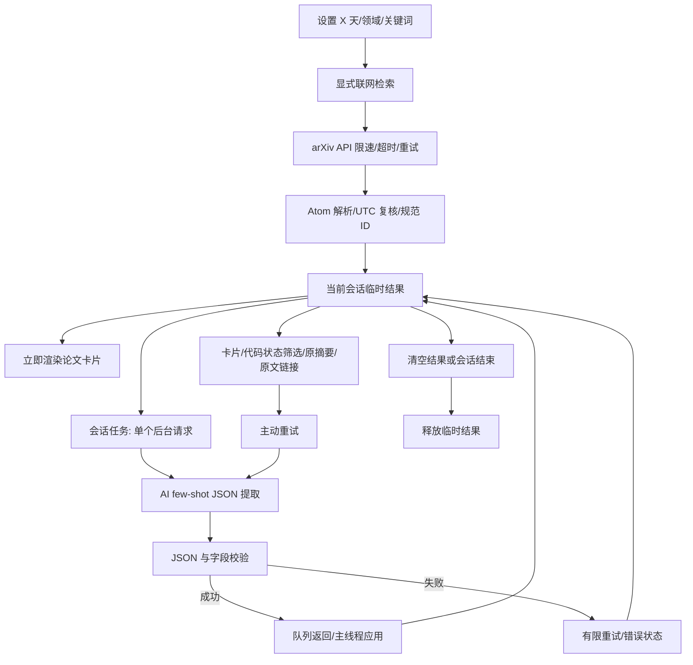

# TDD：车辆加速度预测文献追踪看板

## 1. 技术与数据生命周期

Python 3.12、Streamlit、requests、python-dotenv，JSON/XML/测试使用标准库。已验证依赖（含传递依赖）统一固定于 requirements.txt。

论文数据只在单个 Streamlit session_state 中临时存在，不使用 SQLite、文件持久化、浏览器 localStorage 或跨会话数据缓存。数据库和本地论文筛选已按用户要求移除。

## 2. 架构与数据流



新搜索在来源请求成功后清空旧结果；来源失败保留当前会话已有结果。下一批固定原查询时间并合并 ID。同一会话的成功摘要复用；不同会话不共享论文或摘要。

## 3. 模块

| 文件 | 职责 |
| --- | --- |
| app.py | 输入、来源操作、当前会话结果、状态筛选、重试和卡片 |
| src/session_results.py | 纯内存 SessionResults，不访问文件或数据库 |
| src/models.py | Paper、Summary、UTC 时间与内容指纹 |
| src/search_terms.py | 常见科研术语展开、自由关键词分组、查询文字转义 |
| src/query_translation.py | 非词表中文的忠实英文关键词翻译、严格 JSON 与有限等待 |
| src/fetch_papers.py | arXiv 查询、分页、限速、XML 解析、日期复核 |
| src/ai_summary.py | Few-shot Prompt、AI HTTP 请求、JSON 校验 |
| src/http_client.py | 一次 HTTP 请求、状态分类、共享有限重试预算 |
| src/pipeline.py | 逐篇提取、会话内复用、失败隔离 |
| src/ai_jobs.py | 会话内单请求后台任务、结果队列、取消与主线程消费 |
| src/config.py | .env/环境变量与项目相对路径，密钥 repr 隐藏 |
| src/style.css | 工作台主题与响应式样式，与七项交付一同下载 |

本机额外保留 scripts/（启动器、接口检查）、tests/（离线测试）、README 等辅助文件，但不进入精简后的 GitHub。下载者按 PRD 第 8 节直接运行 app.py，不需要这些文件。

## 4. arXiv API

GET https://export.arxiv.org/api/query

| 参数 | 契约 |
| --- | --- |
| search_query | 领域和关键词表达式 AND submittedDate:[YYYYMMDDHHMM TO YYYYMMDDHHMM] |
| start | 第一批 0，下一批为上次 next_start |
| max_results | 每批 1–50 篇 |
| sortBy/sortOrder | submittedDate / descending |

X 为 1–3650 天，默认 180；查询开始固定 UTC 截止时间，下一批复用。解析 published 后再次精确复核，不用 updated 冒充新论文。Atom 必须有合法 totalResults 和完整元数据，格式错误不是正常无结果。

Paper 字段：id、title、authors、published、updated、abstract、url。去掉 arXiv 版本号规范 ID；保留原摘要与来源链接。FetchResult 还包括 total、truncated、start、end、query、offset、next_start。

请求含重试在同一进程共享至少 3.1 秒间隔；连接/读取超时 10/35 秒。每次只获取一批，下一批由用户主动操作。会话最多展示 200 篇。

综合追踪空关键词沿用领域预设；自定义词使用车辆/跟驰/自动驾驶/交通与预测范围，再与关键词取交集。用户明确选择不限领域时只限定关键词和日期，且必须输入词。非全领域预设保留已记录的标题主题排除规则。命中是 API 条件匹配，不保证全部经过人工相关性审查。

中文图神经网络展开 GNN/GCN/GAT 及全称；概念内部 OR，多个概念 AND。其他中文允许提交，仅在新检索时尝试 AI 翻译原始词，成功后以英文查询，失败则按原词查询并明确提示。普通英文词以 AND 组合，双引号保留短语；查询操作符不作为用户指令执行。字段中的引号与反斜杠被转义。

关键词翻译契约：输入原词（最多 200 字符），Few-shot 输出恰好一个 english_query 字段，非空、最多 200 字符、可打印 ASCII 且含英数字；不添加领域或论文事实。JSON/字段失败重试；全部尝试共享 12 秒预算，连接至多 3 秒、读取空闲至多 5 秒。翻译失败不是来源失败，不禁止联网。原词、英文词和失败提示只存当前 online_search；下一批复用 resolved_keyword，不重复翻译。已有摘要请求尚未结束时跳过额外翻译，保留单会话一个 AI 请求的边界。

## 5. AI 契约

配置 AI_BASE_URL、AI_API_KEY、AI_MODEL，环境变量优先于 .env。未配置基础地址和模型时默认 DeepSeek 官方地址与 deepseek-flash，密钥默认空。每次操作重新读配置；远程使用 HTTPS，地址不含 /chat/completions、用户凭据或查询参数。

POST 基础地址 + /chat/completions，Bearer 认证，非流式：
```json
{
  "model": "配置的模型",
  "messages": [
    {"role":"system","content":"只按当前标题和摘要提取，返回指定 JSON"},
    {"role":"user","content":"人工示例"},
    {"role":"assistant","content":"示例 JSON"},
    {"role":"user","content":"当前论文数据"}
  ],
  "stream": false,
  "max_tokens": 1200
}
```

官方 DeepSeek 额外发送 thinking.type=disabled 与 response_format.type=json_object；其他供应商发送通用参数。读取 choices[0].message.content：
```json
{
  "core_contribution": "一句话中文贡献",
  "methods_and_datasets": "材料明确说明的方法/数据集，未提及写未说明",
  "code_status": "Unknown"
}
```

恰好三个非空字符串字段；前两个各不超过 1200 字符，整体不超过 6000；状态限 Yes/No/Unknown。拒绝重复键、额外字段、错误类型、空响应、截断。允许单个完整 json 围栏，不从混杂文本硬截 JSON。

Prompt 有三个明确的人工示例，分别演示已公开、未来公开和明确不公开。论文中的指令仅视为数据，不补写事实。仅提供标题与摘要，不发密钥到 Prompt，也不解析全文。

AI 仍使用非流式生成（stream=false），但 HTTP 客户端以流式方式读取响应，逐字节检查截止时间和 128 KiB 长度上限，避免上游空白保活无限延长等待。单篇尝试共享 45 秒预算，连接超时至多 5 秒、读取空闲超时至多 15 秒，且均不超过剩余预算。45 秒不是操作系统级强杀时限：截止时若阻塞在读操作中，还需等当前读取超时结束。

## 6. 会话状态契约

SessionResults 内部为 ID 到记录的字典，不接收磁盘路径，不导入 sqlite3，也不读写数据文件。记录含 Paper 元数据、fingerprint、三个提取字段、pending/success/failed 状态与受控错误信息。

upsert 依据 ID/指纹去重；变化时清空旧提取。set_summary/set_error 再比对 fingerprint，避免旧内容结果覆盖新内容。同一会话的下一批可以复用成功摘要；新的联网搜索成功时 clear，然后展示本轮结果。清空按钮移除 paper_results、online_search、last_report。新会话不从其他会话恢复结果。

按 PRD 启动命令显式设置 server.disconnectedSessionTTL=0，不为已断开会话保留恢复缓存。当前页面显示仍需要临时内存，最多 200 篇；这是运行所需，不是本地论文库。新搜索和会话结束后无历史摘要可复用，可能需要重新调用 AI。

页面只按代码状态筛选本轮结果；不存在本地论文搜索/历史计数/下载缓存。卡片分页每页 10 篇，与学术 API 分批是不同层次。

无查询时显示使用引导，不渲染结果统计或筛选栏；来源成功后显示命中数和本轮取得数。新查询成功将代码状态重置为全部。样式集中管理，优先使用项目类名和实际验证过的 Streamlit data-testid；通过实际浏览器检查桌面、390px 窄屏与键盘焦点，避免框架 DOM 变更导致样式失效。

SummaryJob 也只存在当前 session_state。后台 daemon Thread 的目标函数仅持有当前 Paper、配置和 Queue，不访问 Streamlit 或 SessionResults；主线程通过 tick 消费结果，只有消费后才调度下一篇。st.fragment 每秒更新等待信息，有结果时触发页面重绘。任务被丢弃后后台不再自动调度论文。

取消标记使迟到结果失效；新查询成功和清空均先 cancel。未结束的旧请求仍占当前会话的 AI 执行位，不启动第二个重复请求。GC/会话断开后至多当前一条请求自然收尾，无文件或跨会话任务缓存。论文原摘要始终可阅读；已成功摘要在当前会话保留。

## 7. 异常与运行文件

- 来源请求和单篇 AI 最多 3 次总尝试；AI 网络与 JSON 失败共享预算，不叠成 9 次。
- 网络、超时、408/425/429、500/502/503/504 可重试，默认等待 2/4 秒。
- 429 尊重 Retry-After，超过 30 秒停止该操作并提示稍后。
- 400/401/402/403/404/422 明确提示修正，不重试；AI 配置错误停止后续批次。
- 网络、超时、限流和 5xx 用完单篇预算后抛出 TemporaryServiceError，暂停后续 AI 任务；503 提示服务繁忙，不误导为密钥错误。JSON 格式失败仍按单篇隔离处理。
- JSON 失败附格式纠正要求后重试，达到上限保留当前会话失败状态。
- 不打印上游原始错误、请求头或异常字符串；密钥不写论文记录、日志、网页。
- 启动器仍可在 data/ 写最小运行端口/进程信息和服务诊断日志，这些不包含论文结果，不是论文存储。
- .env 为用户配置，保持忽略；无自动 PDF 下载、跨会话缓存和数据库文件。

Windows 启动器以项目专属健康路径识别已有服务，使用文件锁避免重复启动；从 8501–8520 找空闲端口，启动后等待健康，再打开浏览器。不会停止其他应用。更新后端模块时开发者需核实并重启项目服务。

## 8. 验证与参考

离线验证请求/解析/重试/去重、纯内存实例隔离、清空、容量上限、新搜索替换、代码筛选不联网、禁止数据库连接。AppTest 使用人工样本，真实 API 与 AI 另行记录。检索后检查整个项目无论文数据库及备份，浏览器清空/刷新后无历史结果。

- [arXiv API](https://github.com/arXiv/arxiv-docs/blob/develop/source/help/api/user-manual.md)
- [DeepSeek API](https://api-docs.deepseek.com/)
- [Streamlit AppTest](https://docs.streamlit.io/develop/api-reference/app-testing/st.testing.v1.apptest)
- [Streamlit fragment](https://docs.streamlit.io/develop/api-reference/execution-flow/st.fragment)
- [DeepSeek 错误码](https://api-docs.deepseek.com/quick_start/error_codes/)

## 9. 界面设计

### 当前方向

以用户认可的早期青绿色版本为基础，采用浅色检索侧栏、森林绿顶部、白色检索卡片和浅灰绿页面。2026-11-03 第一轮深蓝侧栏版本被用户明确否定，已撤换；不再以该版作为设计基线。

网站用于检索与阅读论文。顶部用车辆交互与轨迹示意表达研究方向；搜索表单位于顶部之后并轻微叠合，保持清楚的主操作。初始页用三张简短引导卡说明流程，避免大面积空白占位。

### 参考资料与使用边界

- [Anthropic 官方 frontend-design 技能](https://github.com/anthropics/skills/blob/main/skills/frontend-design/SKILL.md)：参考视觉方向、排版与完整页面检查。用户反馈优先于通用设计建议；不把遵守参考资料视为美观验收。未全局安装技能，也未执行远程安装脚本。
- [GOV.UK 输入组件](https://design-system.service.gov.uk/components/text-input/)与[按钮规范](https://design-system.service.gov.uk/components/button/)：输入使用固定标签，主操作与次要操作分明。
- [W3C 文字对比度](https://www.w3.org/WAI/WCAG22/Understanding/contrast-minimum.html)与[点击目标](https://www.w3.org/WAI/WCAG22/Understanding/target-size-minimum.html)：检查正文、按钮、焦点和交互尺寸；有限检查不等于完整 WCAG 认证。

### 配色与排版

| 用途 | 色值 |
| --- | --- |
| 页面背景 | #F5F7F6 |
| 卡片与侧栏 | #FFFFFF |
| 正文/标题 | #203B37 |
| 辅助文字 | #5C706C |
| 主操作 | #147D6D |
| 浅色强调区域 | #EDF5F1 |
| 边界 | #DCE5E0 |
| 顶部渐变 | #163F39 → #2E6250 |

统一使用系统无衬线字体，标题、摘要、元数据以字号与字重区分。桌面主标题 36px、论文标题 23px、贡献正文 15px；窄屏相应为 28px、20px、14px。中英文正常换行；状态有明确文字，不只依靠颜色。

### 布局与操作

1. 浅色侧栏集中时间、领域、批量篇数和自动 AI 选项；配置说明折叠。
2. 顶部包含研究方向、简短介绍及车辆图示。图示为内联 SVG 装饰，不代表论文数据或实验结果。
3. 搜索有固定“论文关键词”标签、54px 输入和明显的“联网检索”按钮。
4. 三个快捷词可点击填入：图神经网络、车辆轨迹预测、加速度预测。点击仅填入；用户仍需提交检索，不会因此产生接口请求。
5. 初始页显示三步引导；有查询后显示命中数、本轮取得数、开源筛选与统计。
6. 论文卡片按来源日期/状态、标题、作者、核心贡献、方法与数据集、原摘要、原文入口组织。
7. 下一批放在结果之后；技术检索表达式折叠展示。新搜索成功重置为全部代码状态。

### 实现与验证

样式集中在 src/style.css，使用项目类名和实际观察到的 Streamlit data-testid。不加载外部字体或图片运行库，无自动动画，尊重 prefers-reduced-motion。本地辅助 .streamlit 配置不随最小仓库上传，下载者使用 PRD 中的启动参数。

实际修正过卡片默认 100% 宽度叠加左右外边距的问题，避免搜索区偏出顶部右边界。侧栏去除叠加的内边距，恢复控件宽度。隐藏无用途的标题锚点图标。

浏览器核查默认桌面 1280px 与窄屏 390×844：后者文档宽度为 390px，搜索整行、统计两列、标题和摘要换行；结束后恢复默认视口。快捷词、真实检索和 AI 摘要均在实际页面操作。详细记录见 progress.md。

论文与 AI 结果继续只在当前会话临时展示，不新增历史库、下载缓存或账号。视觉改动不改变来源、提取与异常处理契约。


## 10. 最小交付边界

GitHub 根目录为课程要求的六个文件与 src/ 目录，共七项。CSS 等必需资源放 src/；本地 README、启动器、测试与 .streamlit 配置保留但不上传。仓库不含 Key，使用者自行配置，安装与运行见 PRD 第 8 节。本地测试覆盖最小目录独立启动、自由查询、翻译降级和原有异常边界；测试记录在 progress.md。
